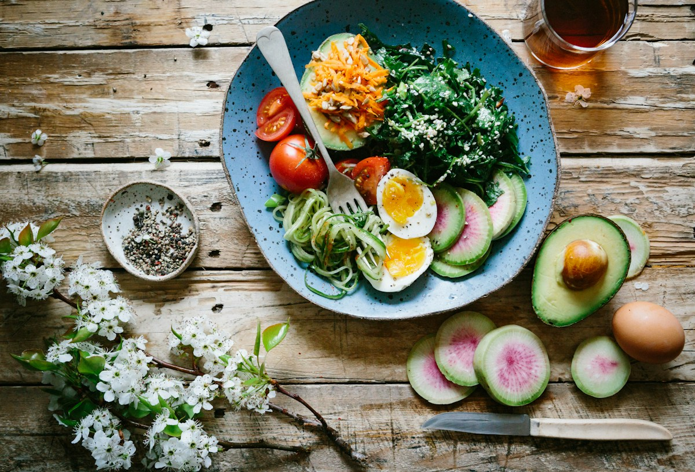

周末的早晨不必安排得太满。先把咖啡煮好，再慢慢把冰箱里剩下的蔬菜洗净、切好。

这一盘没有特别的做法。番茄、鸡蛋和叶菜放在一起，桌边还有一本只翻了几页的书。吃完以后，今天才算真正开始。

## 不用赶着出门

给自己留一段空白，早餐就不只是填饱肚子，也成了周末的一部分。

> 把日子过慢一点，平常的早晨也会有自己的味道。

## 再约一顿饭

真正让这顿饭好吃的，是桌边还坐着想见的人。下次想试试附近那家小店的面包。
